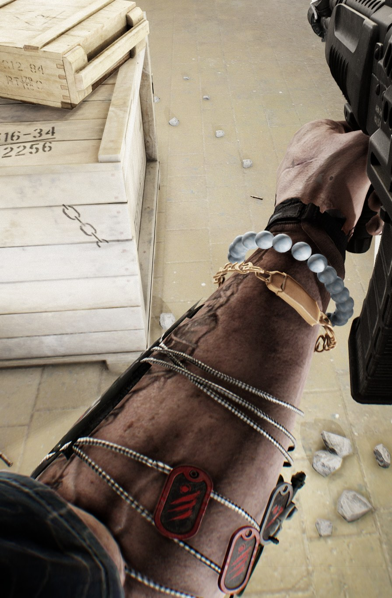
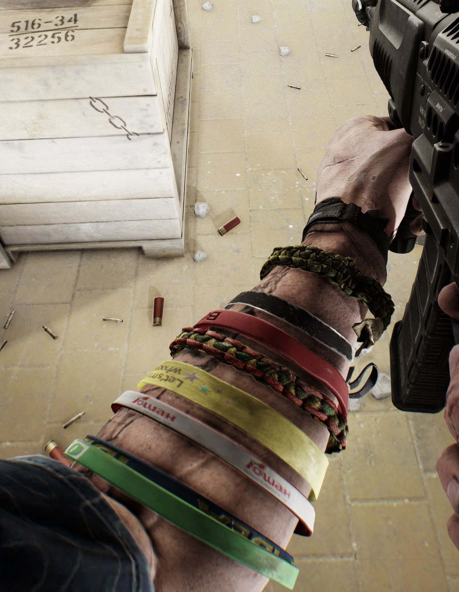
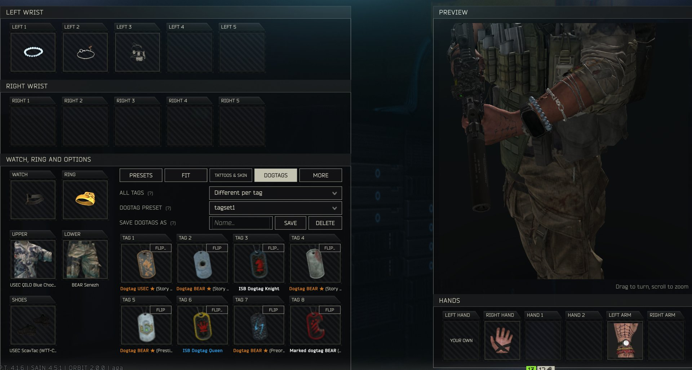
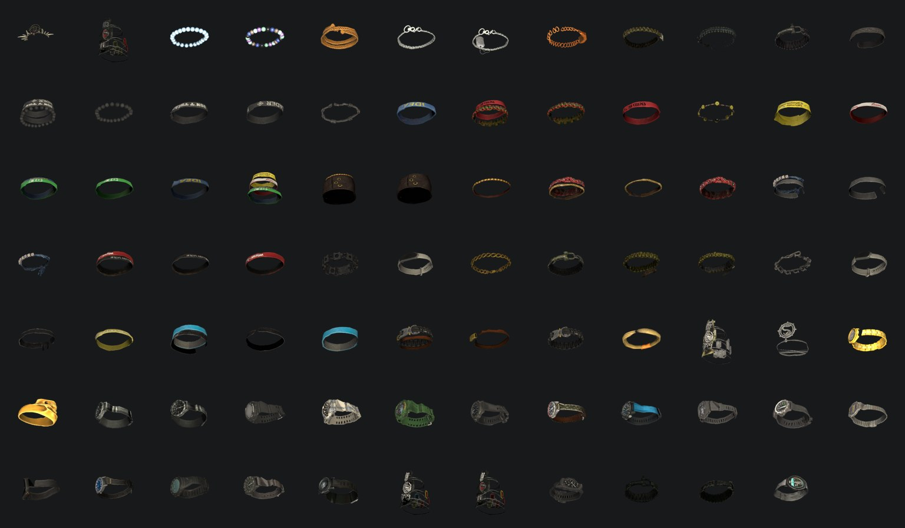
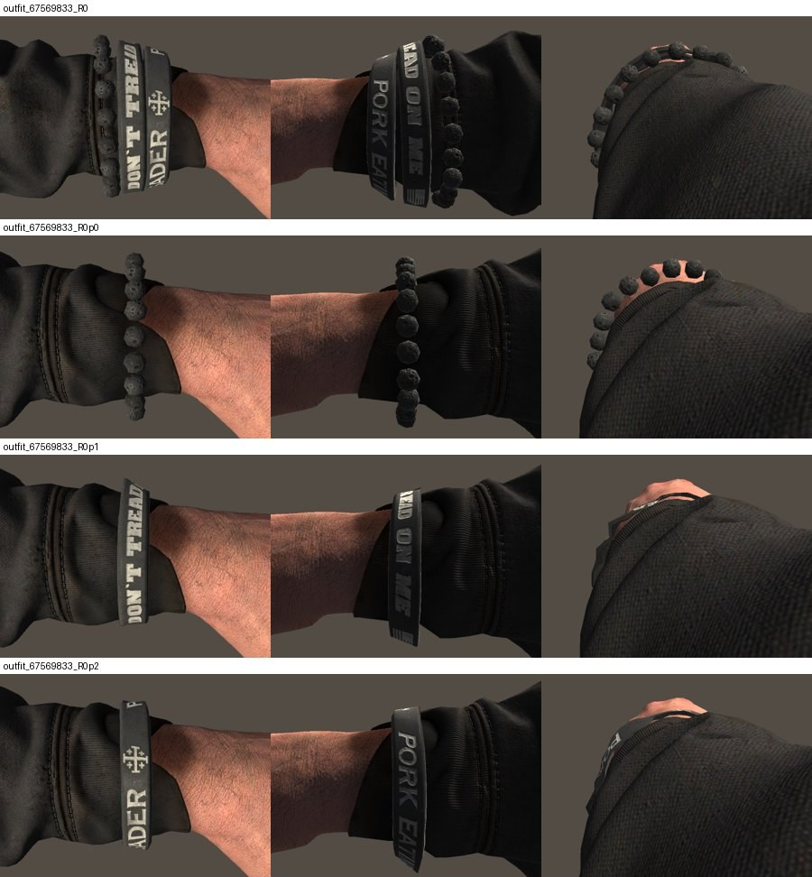
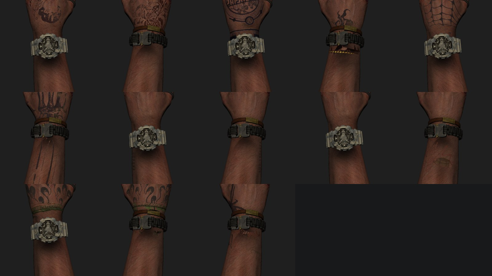
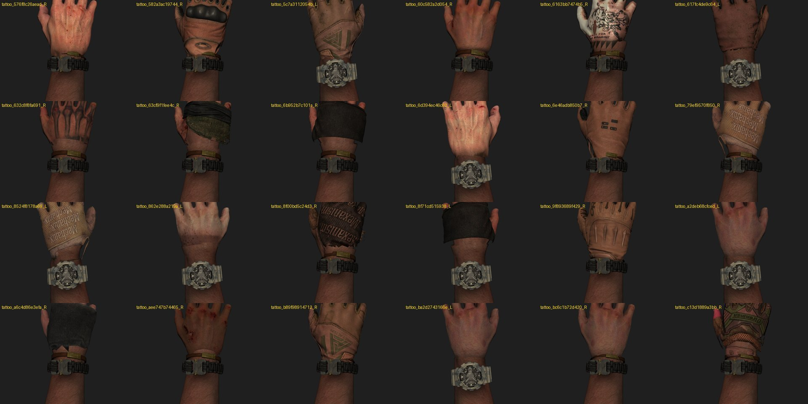
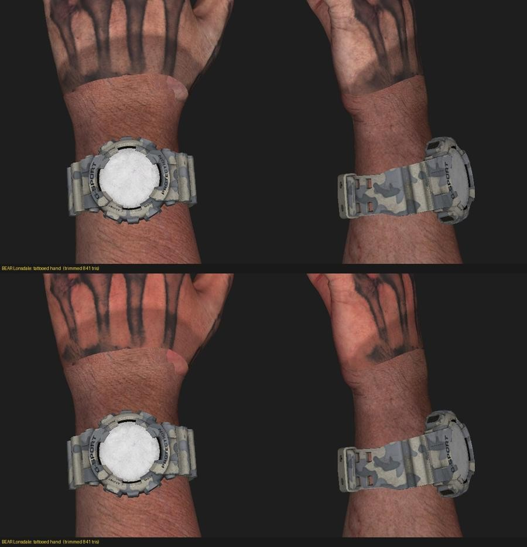

# WristAccessories

**(WORK IN PROGRESS. MAINLY POSTING FOR FEEDBACK/SUGGESTIONS. MADE WITH THE HELP OF AI.)**

adds a new "WARDROBE" tab with a lot of customization to change gloves/shoes/wrist accessories in the game. work in progress, you will very likely see clipping or gaps or invisible parts of your body (likely wrist and ankles with some bracelets/watches/shoes) theres quite a bit of customization even in its current state, im sure you could find something that works smoothly. anyways yeah just lmk if you have any issues, thanks for reading :)

Optional extra cosmetics are included if you also have this mod: [ISB Special Forces](https://sp-mod.com/mod/2485/isb-special-forces)

Thank you so so much to the amazing **Sam C-137** for allowing me to use some of their textures from the ISB Special Forces mod. (go download their mod!!!!)

Client plugin for **SPT 4.1.6** (BepInEx). Wear watches, bracelets, chains, kill sleeves, a skull ring, gloves and shoes from the
game's outfits on **any** outfit, fitted to your sleeve, wrist and pants. You pick them on a new **WARDROBE** tab on the
character screen.

## What it adds
- Everything updates **live**: what you change on the WARDROBE tab shows on your character at once, in the hideout too - no restart, no raid needed.
- **WARDROBE tab** next to the game's own character tabs, with a live preview of your character (drag to turn, scroll to zoom).
- **LEFT 1-5 / RIGHT 1-5**: up to five items per forearm, from the wrist toward the elbow: bracelets, chains, the Prokill
  medallion chain, a dogtag on a chain, paracord, the Sacred Amulet, kill sleeves, dogtag chains and pieces cut from other outfits.
- **PRESETS**: save what you wear under a name and load it again later (everything, only the wrist, or only hands and tattoos).
- **WATCH**: replace your outfit's own watch with one of 16 watches, each named after the outfit it comes from, or wear none.
  The game's own watches keep their moving hands. WATCH WORN "As its outfit wears it" puts each watch exactly where its own
  outfit wears it (same side of the wrist, strap tucked under your cuff); "Over the sleeve / arm" fits it snug round the outside.
- **DOGTAGS**: the 8 hanging tags of the kill sleeves and the dogtag chains, each set to any dogtag of the game and of the mods
  you have installed (Unlock All Dogtags, Black Division, ISB, Moreman's tag...), with pictures, and FLIP to turn a tag over.
- **TATTOOS**: hand and arm tattoos from other outfits, pressed onto your own skin (hidden under sleeves); TATTOO SIZE.
- **RING**: gold skull ring on the left or right hand.
- **LEFT HAND / RIGHT HAND / HAND 1-2**: gloves, other outfits' hands and hand pieces (tape, finger wraps). They bend with your fingers.
- **UPPER / LOWER**: your owned suits, picked right on the tab (the game saves them when you close the screen).
- **SHOES**: another outfit's shoes on your feet, whatever pants you wear. Your own boots are taken out where the new shoe
  covers them, and the shoe is fitted to your pants' hem.
- **Options** (with a tooltip on each): WATCH ON (left / right / both), WATCH FACE (back or inner wrist), ADJUST + ANGLE +
  SLIDE (turn or move any worn item), STRAIGHTEN BRACELETS, SKIN SHADE, MATCH SKIN TONE, ON YOUR SCAV, WATCHES IN WRIST
  SLOTS (more than one watch per arm), EVERY SHOE (also the shoes only bots wear: zombies, bosses, scavs, guards),
  CLEAN SKIN UNDER WATCH, SAME ON BOTH HANDS (a left or right hand also puts on the same outfit's other hand), QUICK UNEQUIP
  (middle or right click a tile to take that item off), PICKS PER PROFILE (each SPT profile keeps its own picks).
- Every setting is also in F12 (BepInEx Configuration Manager) -> WristAccessories.

## Pictures
In game (first person):

The WARDROBE tab:

Every wrist item and watch in the release (each outfit's bracelets also come one by one):

An outfit's bracelet set, together and one by one (USEC Special Ops):

Arm tattoos on any top, pressed onto your own arm and hidden under sleeves:

Hands from other outfits; the seam at the wrist before (top) and after the blend (bottom):

(The pictures after the WARDROBE tab are from the Unity test scene the item data is checked in.)

## Recommended mods
- **[WTT-ContentBackport](https://sp-mod.com/mod/2512/wtt-content-backport)** - adds WAY more customization: its outfits add many more watches, bracelets, hands, gloves and shoes
  to the lists.
- **[ISB Special Forces](https://sp-mod.com/mod/2485/isb-special-forces)** by Sam C-137 - extra bracelets, gloves, hands and shoes from its
  outfits (needs WTT-ContentBackport too).
- **[Manimal's Watch Animations](https://sp-mod.com/mod/2745/manimals-watch-animations)** (Manimal.WatchAnims) - animations for checking your watch; WristAccessories picks the one that
  matches where your watch face sits (back or inside of the wrist).
- **[Hj's Improved Customization UI](https://sp-mod.com/mod/3069/hjs-improved-customization-ui)** - a better clothing / customization
  screen; works side by side with the WARDROBE tab.
- **[Unlock All Dogtags](https://sp-mod.com/mod/3013/unlockalldogtags)** by MyButtHasARash - adds a lot more dogtag customization!

## Requirements
- SPT 4.1.6 (BepInEx comes with SPT).
- Optional: **[WTT-ContentBackport](https://sp-mod.com/mod/2512/wtt-content-backport)** - adds way more customization. Many watches, items, hands and shoes come from its outfits;
  they are only listed when it is installed.
- Optional: **[ISB Special Forces](https://sp-mod.com/mod/2485/isb-special-forces)** (folder `ISB-Aishi`, with WTT-ContentBackport). The included `WristAccessories-ISB` folder adds items cut from its outfits
  (bracelets, gloves and hands, shoes); it only loads when both are installed.

## Install
Unzip into your SPT folder (the one with `EscapeFromTarkov.exe`), so you get
`BepInEx\plugins\WristAccessories\WristAccessories.dll` and its data folder. Client only: nothing goes on the server.

## Uninstall
Delete `BepInEx\plugins\WristAccessories` and `BepInEx\plugins\WristAccessories-ISB` (and `BepInEx\config\com.amos.wristaccessories.cfg` for your settings).

Safe to remove: your profile doesn't depend on this mod. The only thing it saves to your profile is the outfit you pick with UPPER / LOWER (or a preset with clothing), exactly as the game's own clothing screen does, and always a suit you own.

## Compatibility
- **Fika**: works, but other players don't see your accessories (nothing is synced).
- **Manimal-WatchAnims** (optional): its "look at your watch" animation then matches where your picked watch sits on
  the wrist, and it also plays in the hideout.

## Known issues
- Hands taken from other outfits (LEFT HAND / RIGHT HAND) can show a jagged edge across the back of the hand. A fix is coming.
- Some outfits still look a bit buggy in the WARDROBE 3D preview.
- Rings and finger tape on the FINGERS tab are a work in progress: they don't line up perfectly with every hand yet.
- The 3D preview on the WARDROBE tab can look different from first person (for example, watches worn "as its outfit wears it"
  show over the sleeve in the preview).

## Troubleshooting
Every line from this mod starts with `[WristAccessories]` in `BepInEx\LogOutput.log`. Please include those lines in a bug report.

## Credits
- Made by amos.
- Built with Claude Code (Anthropic's Claude) as a coding assistant: code, the offline tools that cut the items from the
  game's outfits, and testing in a Unity lab.
- Items, watches, gloves and shoes come from Escape from Tarkov's own outfits (and WTT-ContentBackport's outfits when installed).
- The ISB items come from Sam C-137's [ISB Special Forces](https://sp-mod.com/mod/2485/isb-special-forces) outfits. Thank you!
- Shoutout to the GOAT [Soap](https://sp-mod.com/user/37131/soap-0141) for being the GOAT and for being my most loyal tester and friend. thank you twin :aga:

## License
MIT for the plugin code, see `LICENSE`. The item data (`acc/`, `watchshadow/`) is derived from Escape from Tarkov's and
other mods' outfits; it is not covered by the license and belongs to its owners.

## Building from source
`src/` holds the plugin. Build with the .NET SDK: `dotnet build src -c Release -o out -p:SPTPath="<your SPT folder>"`
(it references BepInEx, Harmony and the game's own assemblies from that SPT install). The item data in the release zip
(`acc/`, `watchshadow/`, outlines) is generated by the offline tools in `tools/` (see `tools/README.md`).
